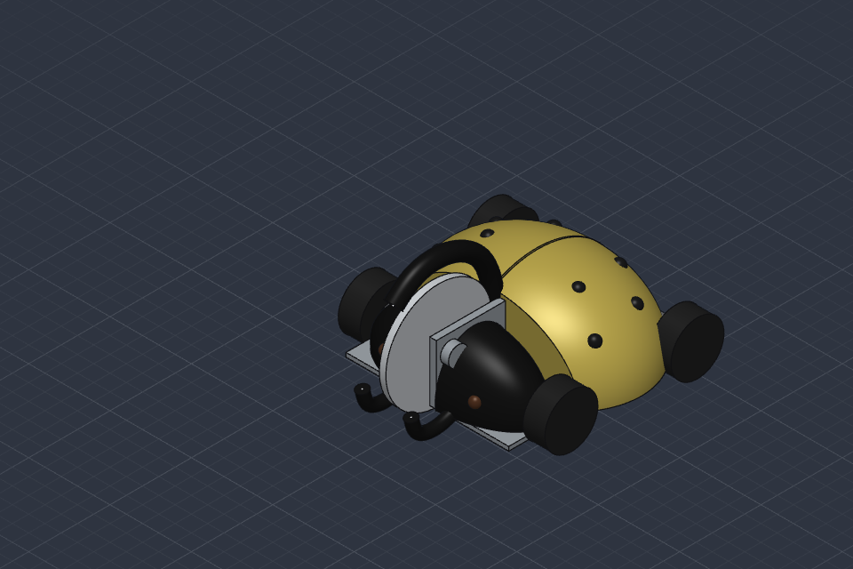

# BattleBot — Hércules

Robot de combate de 3 kg para la competencia **BotCrash CETI 2026A**, inspirado en el escarabajo Hércules.
Proyecto de hardware abierto: CAD, firmware, electrónica y documentación en un solo repositorio.

> **Estado:** etapa de concepto. El diseño mecánico se está rehaciendo con piezas reales;
> el peso estimado del concepto actual (~3.9 kg) todavía supera el límite de 3 kg.

## Especificaciones (objetivo)

| | |
|---|---|
| Peso | ≤ 3 kg con batería y armas |
| Tamaño | ≤ 300 × 300 × 300 mm al inicio del combate |
| Arma | Disco vertical de acero, motor de 24 V con banda |
| Tracción | 4 motorreductores JGA25-370 (12 V, 170 RPM), ruedas de 65 mm |
| Control | ESP32-S3 + control de Xbox Series X por Bluetooth (BLE) con failsafe |
| Baterías | 3S Li-ion para tracción y electrónica · 5S Li-ion para el arma |

## Estructura del repositorio

| Carpeta | Contenido |
|---|---|
| [`docs/`](docs/) | Documentación y sitio web (MkDocs): reglamento, diseño, ensamble, electrónica, pruebas |
| [`hardware/cad/`](hardware/cad/) | Archivos fuente (SolidWorks, build123d), STEP exportados, conceptos y renders |
| [`hardware/print/`](hardware/print/) | Piezas para impresión 3D (STL/3MF) y perfiles de laminado |
| [`hardware/cut/`](hardware/cut/) | Placas para corte (DXF) |
| [`hardware/electronics/`](hardware/electronics/) | Diagrama de conexiones, esquemático y PCB |
| [`hardware/bom/`](hardware/bom/) | Lista de materiales con costo y peso |
| [`firmware/`](firmware/) | Firmware del ESP32-S3 (PlatformIO) |
| [`tools/`](tools/) | Scripts de apoyo: cálculo de peso, video promocional |
| [`simulation/`](simulation/) | Modelo del robot para simulación (futuro) |

## Seguridad

Este robot tiene un arma giratoria y baterías de litio. Usa siempre gafas y guantes,
coloca el seguro mecánico del arma al transportarlo y no lo enciendas fuera del área autorizada.
Consulta [`docs/reglamento.md`](docs/reglamento.md) para la lista de verificación de inspección.

## Licencia

- Código (firmware y scripts): [MIT](LICENSE)
- Diseños de hardware y documentación: [CC BY-SA 4.0](LICENSE-HARDWARE)

## Autor

Jose Ramon Navarro
