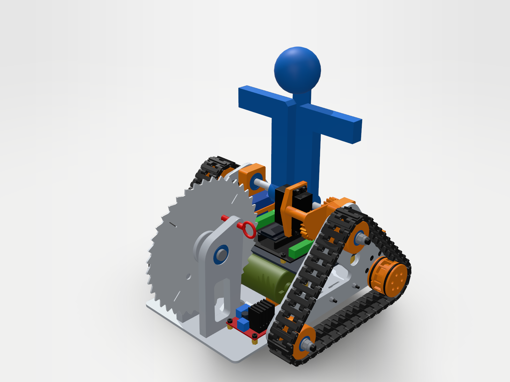
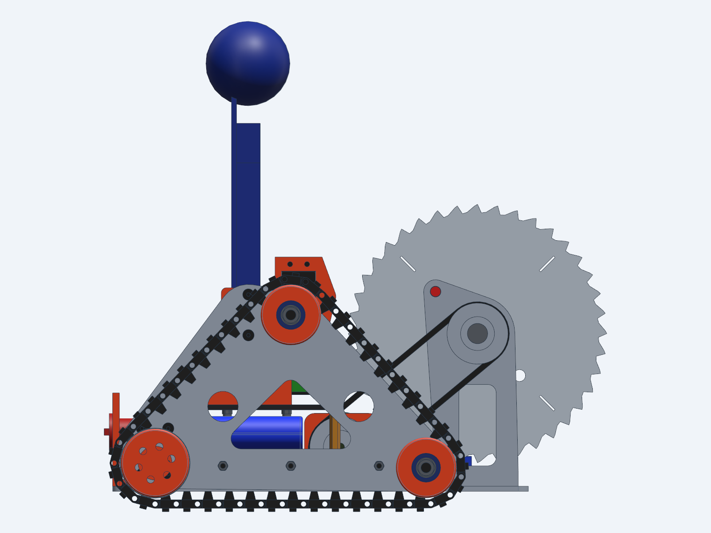
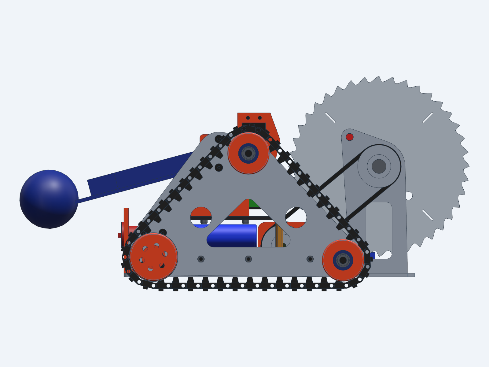
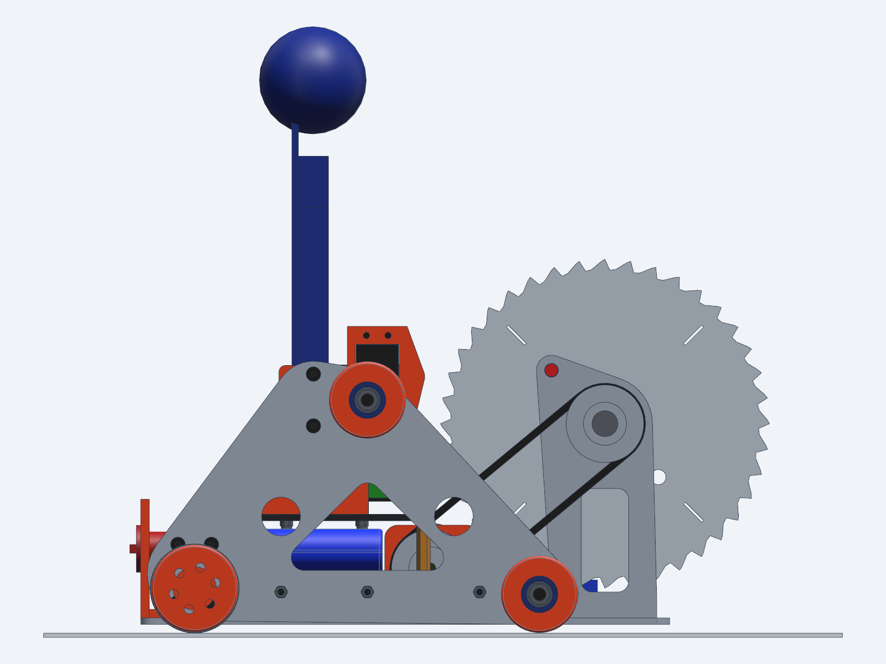

# Ensamble de ejemplo v1

Ensamble completo con los componentes que tenemos, para revisar acomodo, espacio y peso.
**Es un ejemplo para discutir, no un diseño para fabricar todavía**: varias medidas de piezas compradas
son supuestas (ver [Supuestos](#supuestos)).

| Vista lateral | Martillo al final del golpe | Sin orugas (sigue andando) |
| --- | --- | --- |
|  |  |  |

## Cambios respecto a la v0

| v0 | v1 | Por qué |
| --- | --- | --- |
| Catarina motriz arriba | **Catarina motriz abajo atrás** y rueda libre arriba | Si se pierde la oruga, el robot sigue apoyado en las catarinas y puede moverse |
| Catarina lisa | **2 O-rings 35 × 3 mm por catarina** | Son la llanta de emergencia sin oruga; quedan 0.13 mm debajo de los eslabones |
| Motor de podadora supuesto (Ø60, 600 g) y disco de acero Ø130 × 6 | **Motor 775 de 20 V de la desbrozadora** (Ø41.81 × 67 mm, 98 mm con ejes) y su **hoja de sierra de 6"** | Es el arma elegida |
| Disco a 72 mm de altura | Hoja a 105 mm | La hoja de 6" es más grande; nunca toca el piso, aun sin orugas |
| Tornillos con cabeza bajo la base | **Todos avellanados al ras** | Sin orugas, la base queda a 4 mm del piso |
| Banda HTD-5M sin largo definido | **Banda HTD-5M de 310 mm** (62 dientes), centros a 105 mm | Largo estándar que deja ≈ 8 mm entre la hoja y el motor |
| Collarines de acero | Bridas de aluminio con maza | −150 g |

## Martillo: el monito del CETI

| Elemento | Solución |
| --- | --- |
| Monito | Proporciones del STL de referencia a **escala 3**: 166 mm de ancho, 185 mm de alto, 14 mm de grueso. Placa trasera de 3 mm que une las mitades y la cabeza (una sola pieza impresa en PETG) |
| Pies | Las dos piernas están **paradas en el eje de giro**: los pies son dos mazas redondas de Ø24 que abrazan el eje, cada una con un prisionero M4 |
| Tamaño | Es el más grande que cabe: con el monito parado el robot mide 289.5 mm de alto (límite 300 mm) |
| Eje | Aluminio de 8 mm a lo ancho del robot, a 116 mm de altura, sobre 2 × **608-2RS** en soportes impresos atornillados a las placas laterales |
| Servo | **MG995**, adelante y abajo del eje, atornillado por sus orejas a una placa del soporte izquierdo |
| Transmisión | Engranes rectos de módulo 1.5, **20 y 20 dientes (1:1)**: el martillo gira lo mismo que el servo y recibe todo su torque (9.4–11 kg·cm) |
| Recorrido | Parado en reposo; gira hasta **105° hacia atrás** (lado contrario a la sierra), dentro de los 180° del servo. Se revisó cada 15°: no toca nada del robot |
| Alcance | Al final del golpe la cabeza queda ≈ 70 mm detrás del robot |

- El reglamento permite hasta **2 armas**: sierra + martillo.
- El servo **no** necesita driver: se controla con una señal PWM del ESP32 (GPIO 9). Se alimenta con un
  regulador (BEC) de 6 V desde la 3S, no del 5 V de la Freenove (el servo puede pedir 1–2.5 A al arrancar
  y reiniciaría al ESP32).
- Torque: con el monito impreso con relleno (≈ 100 g) el servo lo sostiene acostado con mucho margen,
  pero un golpe fuerte contra el monito puede barrer los engranes del servo. Conviene un servo de más
  torque si se usa en serio (p. ej. de 20–25 kg·cm con el mismo tamaño).
- Con el robot en reposo el monito queda dentro del cubo de 300 mm; al golpear sale por detrás (confirmar
  con los jueces cómo miden el tamaño).

## Archivos

- Modelo paramétrico: [`hardware/cad/source/battlebot_ejemplo.py`](../../hardware/cad/source/battlebot_ejemplo.py)
  (build123d / text-to-cad). Las medidas principales están al principio del archivo.
- STEP para SolidWorks en `hardware/cad/step/`:
  - `battlebot-ejemplo-v1.step`: ensamble completo.
  - `battlebot-ejemplo-v1-sin-orugas.step`: el robot sin orugas, apoyado en el piso.
  - `battlebot-ejemplo-v1-martillo-golpe.step`: el martillo al final del golpe (105°).
  - Uno por pieza fabricada: `eslabon-oruga-v1`, `catarina-v1`, `rueda-libre-v1`, `placa-lateral-v1`,
    `placa-base-v1`, `poste-eje-arma-v1`, `soporte-motor-arma-v1`, `hoja-sierra-6in-v1`, `monito-ceti-v1`.

## Qué tiene

| Sistema | Solución |
| --- | --- |
| Tamaño total | **296.2 × 250 × 289.5 mm** con el martillo parado (largo × ancho × alto): cabe en el cubo de 300 mm |
| Chasis | Placa base de aluminio de 3 mm; placas laterales de aluminio de 5 mm unidas con 6 tramos de ángulo de 3/4" × 1/8" |
| Tracción | 2 × JGB37-520 abajo atrás, atornillados a las placas laterales (6 × M3 × 8 avellanados) |
| Orugas | Triangulares, 43 eslabones de paso 12.5 mm, guía central y taco; pernos de hilo de nylon de 3 mm |
| Catarina | 12 dientes que empujan la guía de cada eslabón; 2 O-rings; barreno en D de 6 mm + prisionero M3 |
| Ruedas libres | Delantera (en ranura de ±4 mm para tensar) y de arriba; Ø35.6 × 28 mm, 2 × **606-2RS** cada una, tornillo M6 × 50 |
| Arma | Hoja de 6" en eje de 12 mm con 2 × **6201-2RS** en postes de aluminio de 10 mm; banda HTD-5M 310 mm desde el motor de la desbrozadora |
| Seguro mecánico | Perno de 6 mm con argolla que atraviesa los dos postes y un barreno de 7 mm en la hoja |
| Electrónica | Baterías 18650 3S (abajo) y 5S (arriba) al centro; encima, una cubierta con la Freenove + ESP32-S3, el relevador y la pila de 9 V del ESP32; L298N al frente |
| Interruptores | General y del arma en la pared trasera, entre los motores |

## Qué pasa si se pierde la oruga

Calculado en el modelo (`battlebot_sin_orugas`):

- El robot baja **7.95 mm** y queda apoyado en los **O-rings de las catarinas motrices** y en las
  **ruedas delanteras** (0.18 mm más arriba).
- Lo siguiente más bajo es la placa lateral y la placa base, a **≈ 4 mm del piso**. La hoja queda a ≈ 21 mm.
- Si se pierde **una sola** oruga, ese lado sigue empujando con su catarina: el robot conserva el control.
- Con O-rings en piso liso el agarre es menor que con la oruga: sirve para seguir moviéndose y no perder
  por inmovilidad, no para empujar.

## Revisión

- **Interferencias: ninguna** entre las 281 piezas, en reposo y con el martillo al final del golpe (`cad model interference`), y ninguna en todo el recorrido del martillo (revisado cada 15°).
- Distancia de la punta de la hoja al motor del arma: ≈ 7.9 mm.
- Velocidad teórica de la oruga: 12 dientes × 12.5 mm × 333 RPM ≈ 0.83 m/s sin carga.

## Peso

Calculado con el volumen del modelo (aluminio 2.70, acero 7.85, PETG 1.27, TPU 1.21 g/cm³) y el peso de
catálogo o estimado de las piezas compradas.

| Grupo | Peso (g) |
| --- | ---: |
| Baterías 18650 5S + 3S y pila de 9 V con porta pila | 460 |
| Motor del arma (**estimado**) | 350 |
| Motores JGB37-520 (2) | 340 |
| Placas laterales (2, aluminio 5 mm) | 323 |
| Placa base | 264 |
| Hoja de 6" | 232 |
| Postes del arma (2) | 212 |
| Orugas (86 eslabones) | 181 |
| Eje, rodamientos 6201, bridas, poleas y banda | 300 |
| Catarinas, ruedas libres, rodamientos 606 y O-rings | 228 |
| Electrónica, interruptores, pared y cubierta | 277 |
| Tornillería, ángulos y separadores | 208 |
| Martillo: monito (impreso con relleno, ≈ 100 g), eje, 608, soportes, engranes, servo MG995 y tornillos | ≈ 265 |
| **Total** | **≈ 3690 g** |

**Se pasa ≈ 690 g del límite de 3 kg.** Por dónde recortar:

1. **Placas laterales**: de aluminio de 5 mm a PETG impreso de 6–8 mm (caben en la K1 SE) → ≈ −130 a −170 g; o aluminio de 3 mm → −120 g.
2. **Postes del arma** de 10 mm macizos a 6 mm con ventana grande (y rodamientos 6901, más delgados) → −90 g.
3. **Placa base**: más aligeramientos → −60 g.
4. **Baterías y motor del arma**: pesarlos; entre los tres suman ≈ 775 g estimados.
5. Cubierta y pared trasera más delgadas o caladas → −30 g.
6. **Martillo**: monito más chico o más hueco → −30 a −60 g; o quitar el martillo (≈ −265 g).

Aun con todos los recortes de arriba (≈ −450 g) el robot sigue pasado: **con sierra + martillo hay que
quitar o aligerar algo grande** (p. ej. placas laterales impresas, motor o hoja más ligeros, o el martillo).

Materiales y orientación de impresión de cada pieza: [impresion-3d.md](impresion-3d.md).

## Supuestos

- **Motor del arma**: 775 de 20 V; diámetro medido (41.81 mm) y largo, eje y punta trasera del plano del
  motor. Los barrenos de la cara (2 × M4 a 29 mm) y el peso (350 g) son los típicos del 775: por medir.
- **Hoja**: 1.8 mm de espesor y barreno de 20 mm, por medir.
- **Freenove Breakout** (86 × 88 mm, barrenos supuestos), **L298N** (barrenos a 37 × 37 mm), **relevador**
  (automotriz 12 V 40 A) y **baterías** (paquetes de 18650 de 68 × 95 × 21 y 68 × 58 × 21 mm, calculados): por medir.
- **JGB37-520**: medidas del plano del vendedor (ver la ficha en `hardware/referencias/`).
- Sin cableado, fusibles ni caparazón.

## Pendiente

- [ ] Medir los barrenos de la cara del motor y el espesor y barreno de la hoja.
- [ ] Medir Freenove, L298N, baterías y relevador, y actualizar el modelo.
- [ ] Bajar el peso a ≤ 3 kg (ver arriba).
- [ ] Imprimir 6–8 eslabones y una catarina con O-rings para ajustar holguras.
- [ ] Medir el torque del JGB37-520 (riesgo de que no alcance para girar con orugas).
- [ ] Preguntar a los jueces si aceptan una hoja de sierra con dientes de carburo.
