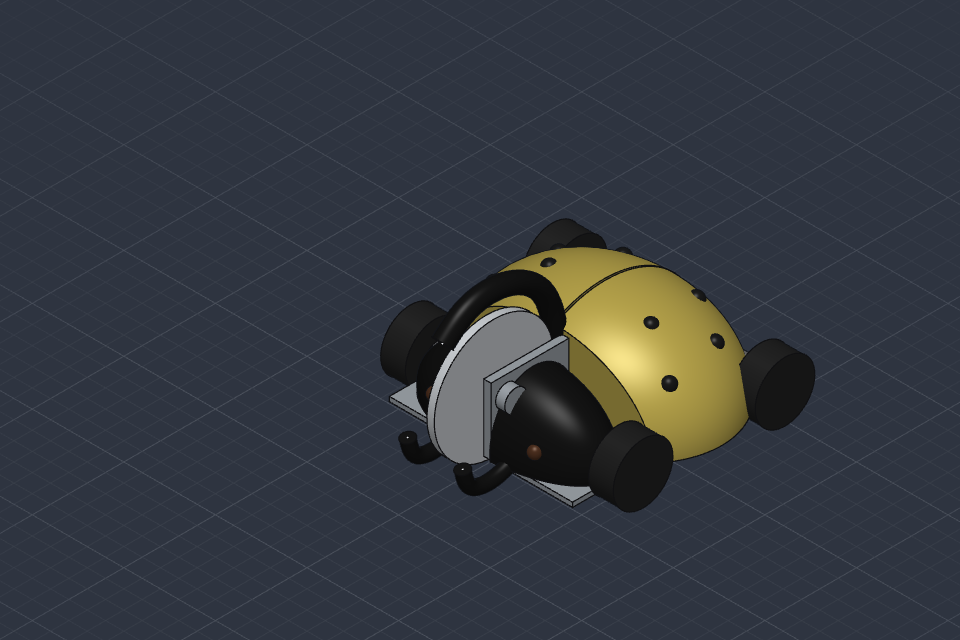

# BattleBot Hércules

Robot de combate de 3 kg para **BotCrash CETI 2026A**, inspirado en el escarabajo Hércules.

## Secciones

- [Reglamento y checklist de inspección](reglamento.md)
- [Diseño y presupuesto de peso](diseno/presupuesto-peso.md)
- Ensamble: *pendiente*
- Electrónica: *pendiente*
- Pruebas: *pendiente*

## Estado del proyecto

| Área | Estado |
|---|---|
| Concepto mecánico | Hecho; falta rediseñar con piezas reales y bajar a 3 kg |
| Electrónica | Componentes definidos; falta diagrama de conexiones |
| Firmware | Por iniciar (ESP32-S3 + control de Xbox con Bluepad32) |
| Pruebas | Por iniciar |
