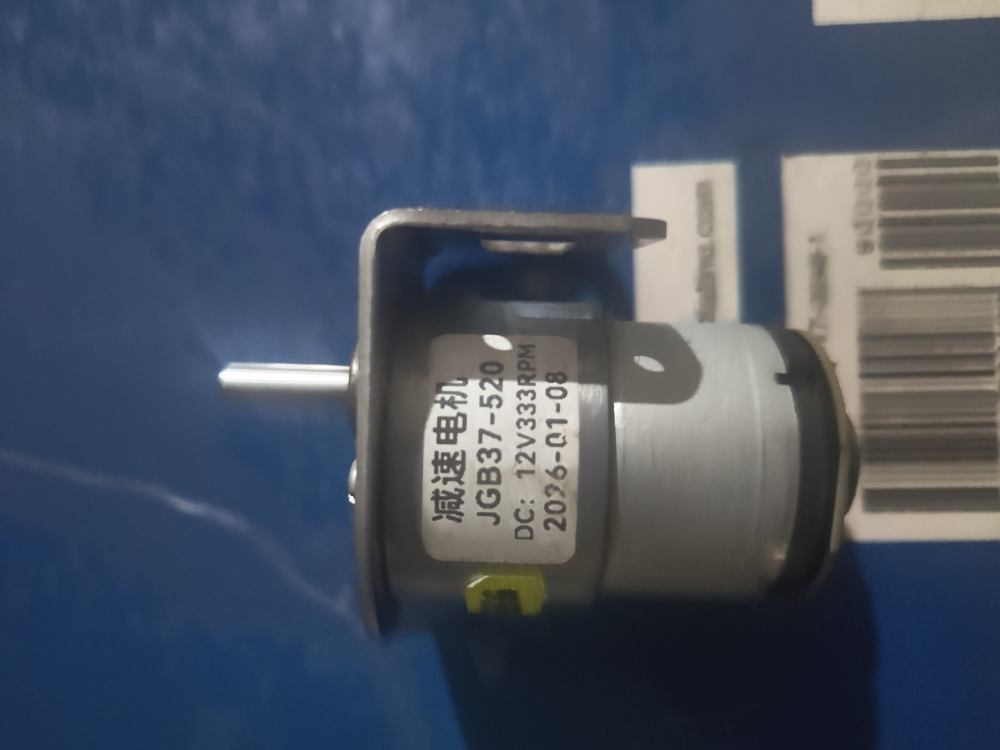

# Motorreductor de tracción JGB37-520 (12 V, 333 RPM)

Ficha de referencia para modelar el motor y su soporte. Las medidas vienen del plano de un vendedor
(ver [Fuentes](#fuentes)); el mismo plano advierte que son "medidas a mano con posible error" y cambian
entre fabricantes. **Toda medida marcada con ⚠ hay que confirmarla con calibrador antes de fabricar.**

## Identificación

| Dato | Valor |
| --- | --- |
| Etiqueta | 减速电机 (motorreductor) JGB37-520, DC 12 V 333 RPM, fecha 2026-01-08 |
| Tipo | Motor de escobillas RS-520 + reductor de engranes rectos con eje descentrado |
| Encoder | No se ve en la foto (la tapa trasera no tiene placa) ⚠ |
| Cantidad en el robot | **2**: una rueda de cada lado, tracción diferencial (gira al mover cada lado a distinta velocidad) |
| Relación de reducción | No viene en la etiqueta. Por la velocidad, probablemente 1:18.8 (tabla de 319 RPM) ⚠ |

## Medidas mecánicas (plano del vendedor)

Sistema: eje de salida a lo largo de +Y. Las medidas de la cara son vistas de frente al eje.

| Elemento | Medida | Notas |
| --- | --- | --- |
| Reductor (carcasa) | Ø37 mm × L | L depende de la reducción: 19 (960–600 RPM), **22 (319–200 RPM)**, 24, 26.5, 29 mm |
| Motor (lata) | Ø33 mm × 22.7 mm | |
| Terminales traseras | sobresalen 6.7 mm, separadas 24.5 mm | 0.5 × 3 mm cada una; el `+` está marcado junto a una terminal |
| Buje trasero | Ø7.5 mm × 3.25 mm | |
| Buje del eje (frente) | Ø12 mm × 6 mm | Sirve para centrar el motor en el soporte |
| Eje de salida | Ø6 mm (−0.03/−0.05), en D con plano a 5.5 mm | Sale 15.5 mm desde el buje; el plano mide 12 mm de largo |
| **Descentrado del eje** | **7 mm** del centro del reductor | El eje NO está al centro: importa para la altura de la rueda |
| Tornillos de la cara | 6 × M3, 4 mm de profundidad, en círculo de Ø31 mm | Cada 60°, dos de ellos sobre la línea horizontal que pasa por el centro del reductor |
| Largo total (sin eje) | ≈ 22.7 + 22 = 44.7 mm (+ 6.7 de terminales) | Con L = 22 ⚠ |
| Largo total con eje | ≈ 66.2 mm (+ 6.7 de terminales) | |
| Peso | ≈ 170 g (vendedor); otra ficha dice 152 g | Pesar en báscula ⚠ |

## Soporte que usamos: bracket Talos para motor 37B / 2342

Comprado en Talos Electronics (SKU TA0669-B6D3, $135 MXN cada uno). Van **2**, uno por motor.

| Dato | Valor | Fuente |
| --- | --- | --- |
| Material | Acero inoxidable 304 | Talos |
| Espesor | 1.8 mm | Talos |
| Peso | 33.1 g | Talos |
| Compatibilidad | Motores 37B (reductor de 37 mm) y 2342 (motor de 42 mm) | Talos |
| Cara del motor | Abertura en forma de "8" para el buje descentrado, barrenos y ranuras radiales para varios patrones | Fotos |
| Base | 4 barrenos y una ventana rectangular al centro; dos muescas de refuerzo en el doblez | Fotos |

Talos no publica plano con medidas: **hay que medir el bracket** (alto, ancho, largo de la base,
patrón de los 4 barrenos de la base, posición del eje respecto a la base) antes de modelarlo.

| Cara del motor | Base |
| --- | --- |
|  |  |

## Soporte en L de otro vendedor (solo comparación)

Plano del soporte que vende rcdrone con este motor. **No es el bracket que usamos**, pero sirve
de referencia para el patrón del motor (6 × Ø3.2 en círculo de Ø31) y la ranura del buje.

| Elemento | Medida |
| --- | --- |
| Material | Lámina de acero de 1.5 mm, doblada a 90° |
| Cara vertical | 40 mm de ancho × 47 mm de alto, remate redondo |
| Barrenos de la cara | 6 × Ø3.2 mm con avellanado o caja de Ø6.3 mm, en círculo de Ø31 mm |
| Ranura para el buje | Ovalada, 2 × R6.5 mm, 14 mm entre centros |
| Base | 40 × 40 mm, 4 × Ø3.5 mm a 24 × 30 mm entre centros, a 8 mm del borde |

Los brackets de lámina (1.5–1.8 mm) sujetan el motor solo por la cara. En combate conviene
agregar una abrazadera o cuna que apoye también el reductor de Ø37.

## Datos eléctricos

| Dato | Valor | Fuente |
| --- | --- | --- |
| Voltaje nominal | 12 V (se usará con la batería 3S, 10.8–12.6 V) | Etiqueta |
| Velocidad sin carga | 333 RPM a 12 V | Etiqueta |
| Corriente nominal | 0.15–0.65 A (rango de toda la serie) | Vendedor |
| Potencia nominal | 2.4–10.8 W (rango de toda la serie) | Vendedor |
| Versión de 319 RPM (1:18.8) | Sin carga 0.1 A; torque de bloqueo ≈ 1.9 kgf·cm a 1.2 A | Tabla de otro vendedor, no verificada |

⚠ La corriente de bloqueo de un motor 520 suele ser varias veces mayor que 1.2 A. **Medirla** con
el motor frenado y un multímetro o fuente con limitador: con ella se dimensionan el controlador de
motores y los fusibles.

## Qué cambia en el diseño

- **No es el motor para el que se diseñó el soporte v1** (`hardware/cad/source/soporte_motor_jga25.py`,
  pensado para el JGA25-370 de Ø25 mm). Ese soporte no sirve para este motor.
- **Velocidad**: con ruedas de 65 mm, 333 RPM dan ≈ 1.13 m/s sin carga (el JGA25 de 170 RPM daba ≈ 0.6 m/s).
- **Peso**: 2 motores × ≈170 g + 2 brackets × 33.1 g = ≈406 g (antes se presupuestaron 4 JGA25, ≈380 g).
- **Eje de 6 mm en D**: hay que confirmar que las ruedas lo aceptan; si no, se necesita un cubo o acople.

## Por medir con calibrador

- [ ] Diámetro y largo del reductor (L) y de la lata del motor.
- [ ] Diámetro del eje, plano de la D y largo libre.
- [ ] Diámetro y alto del buje frontal.
- [ ] Descentrado del eje respecto al reductor.
- [ ] Círculo de tornillos de la cara y si son M3.
- [ ] Peso con y sin soporte.
- [ ] Bracket Talos: alto, ancho, largo de la base, barrenos de la base y altura del eje sobre la base.
- [ ] Si tiene encoder (cables extra en la parte trasera).
- [ ] Corriente sin carga y de bloqueo a 12 V.

## Archivos

- `fotos/`: fotos propias del motor (se suben al repositorio).
- `terceros/`: planos e imágenes del vendedor. Son de terceros, así que **no se suben**
  (están en `.gitignore`); se guardan solo como referencia local.

## Fuentes

Origen de cada imagen de `terceros/` (todas descargadas el 2026-11-15):

| Archivo | Página de origen | Imagen original |
| --- | --- | --- |
| `talos-bracket-37b-cara.jpg` | [Talos Electronics: Bracket para 2342L012 37B](https://www.taloselectronics.com/products/bracket-para-2342l012-37b) | [TA0669_1.jpg](https://cdn.shopify.com/s/files/1/0020/8027/6524/products/TA0669_1.jpg?v=1572374880) |
| `talos-bracket-37b-base.jpg` | [Talos Electronics: Bracket para 2342L012 37B](https://www.taloselectronics.com/products/bracket-para-2342l012-37b) | [TA0669_2.jpg](https://cdn.shopify.com/s/files/1/0020/8027/6524/products/TA0669_2.jpg?v=1572374880) |
| `plano-motor-jgb37-520.png` | [rcdrone.top: JGB37-520 DC gear motor](https://rcdrone.top/products/jgb37-520-dc-gear-motor) | [ScreenShot_..._223021_249.png](https://cdn.shopify.com/s/files/1/0643/3210/3904/files/ScreenShot_2026-09-28_223021_249.png) |
| `plano-soporte-L.png` | [rcdrone.top: JGB37-520 DC gear motor](https://rcdrone.top/products/jgb37-520-dc-gear-motor) | [ScreenShot_..._223031_642.png](https://cdn.shopify.com/s/files/1/0643/3210/3904/files/ScreenShot_2026-09-28_223031_642.png) |
| `especificaciones-jgb37-520.png` | [rcdrone.top: JGB37-520 DC gear motor](https://rcdrone.top/products/jgb37-520-dc-gear-motor) | [ScreenShot_..._223045_229.png](https://cdn.shopify.com/s/files/1/0643/3210/3904/files/ScreenShot_2026-09-28_223045_229.png) |
| `foto-producto-jgb37-520.png` | [rcdrone.top: JGB37-520 DC gear motor](https://rcdrone.top/products/jgb37-520-dc-gear-motor) | [jgb37-520-gear-motor-1.png](https://rcdrone.top/cdn/shop/files/jgb37-520-gear-motor-1.png) |
| `fotos/jgb37-520-con-soporte-01.jpg` | Foto propia del proyecto | — |

Otras páginas consultadas (datos, sin imágenes descargadas):

- Tabla eléctrica de la versión 319 RPM y listados de 333 RPM: [ozrobotics: JGB37-520B 12V 333RPM](https://ozrobotics.com/shop/encoder-reduction-motor-jgb37-520b-12v-dc-deceleration-motor-12v-333rpm/),
  [Core Electronics: ASLONG JGB37-520](https://core-electronics.com.au/aslong-jgb37-520-12v-dc-worm-gear-motor-seeed-studio.html.plain.md).
- Vendedor en México con la misma serie: [UNIT Electronics: JGB37-520](https://uelectronics.com/producto/jgb37-520-motorreductor-12v-319-rpm-_-600-rpm/).
- No se encontró un modelo STEP oficial; el motor se modelará con estas medidas.
