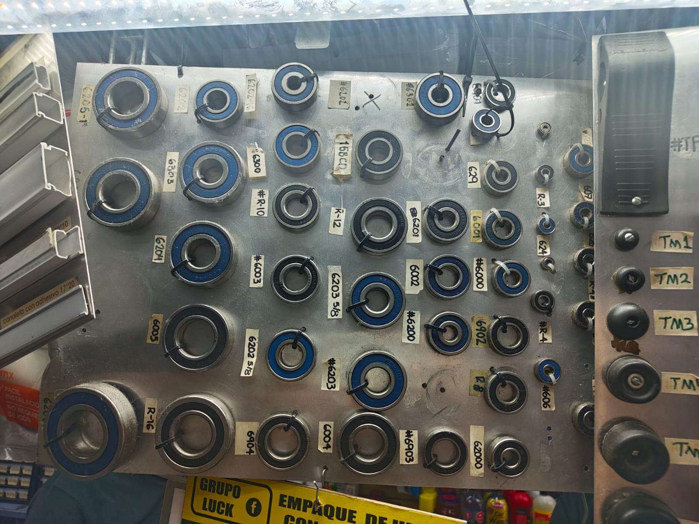
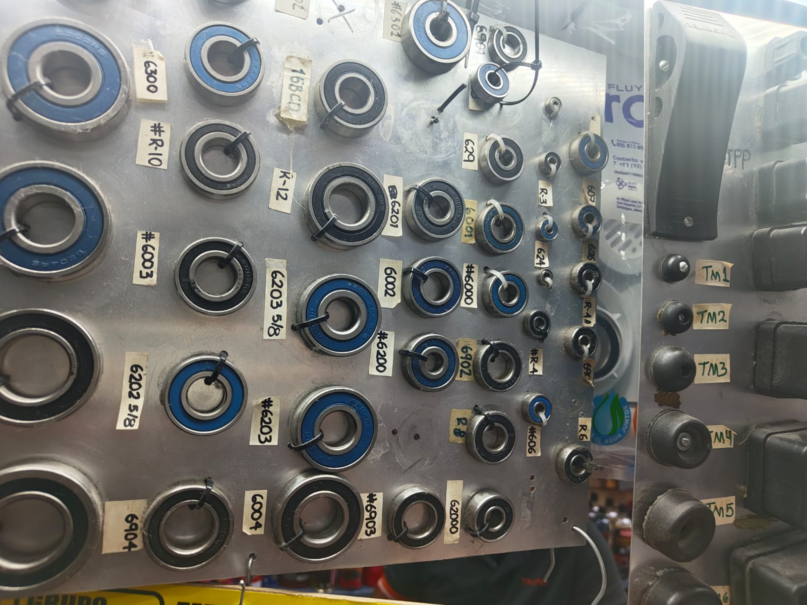

# Rodamientos disponibles en la ferretería

Tablero fotografiado en una ferretería local (2026-11-16). Las medidas son las estándar de cada
número (ISO 15 para las series 6xx, 60xx, 62xx, 63xx y 69xx; las R son medidas en pulgadas).
Los sufijos 2RS (sellos de hule) y ZZ (tapas metálicas) no cambian las medidas.

| Número | Interior d (mm) | Exterior D (mm) | Ancho B (mm) | Notas |
| --- | --- | --- | --- | --- |
| 624 | 4 | 13 | 5 | |
| **606** | **6** | **17** | **6** | **Elegido para las ruedas tensoras de las orugas (eje M6)** |
| 607 | 7 | 19 | 6 | |
| 629 | 9 | 26 | 8 | |
| 6000 | 10 | 26 | 8 | |
| 6001 | 12 | 28 | 8 | Alternativa ligera para el eje del arma |
| 6002 | 15 | 32 | 9 | |
| 6003 | 17 | 35 | 10 | |
| 6004 | 20 | 42 | 12 | |
| 6005 | 25 | 47 | 12 | |
| 6200 | 10 | 30 | 9 | |
| **6201** | **12** | **32** | **10** | **Elegido para el eje del arma (12 mm): aguanta más golpe que el 6001** |
| 6202 | 15 | 35 | 11 | También hay versión con interior de 5/8" (15.875 mm) |
| 6203 | 17 | 40 | 12 | También hay versión con interior de 5/8" |
| 6204 | 20 | 47 | 14 | |
| 6205 | 25 | 52 | 15 | También hay versión con interior de 1" (25.4 mm) |
| 6300 | 10 | 35 | 11 | |
| 6302 | 15 | 42 | 13 | Etiqueta poco legible (6301 o 6302) |
| 6303 | 17 | 47 | 14 | |
| 6901 | 12 | 24 | 6 | Serie delgada |
| 6902 | 15 | 28 | 7 | Serie delgada |
| 6903 | 17 | 30 | 7 | Serie delgada |
| 6904 | 20 | 37 | 9 | Serie delgada |
| R-3 | 4.763 (3/16") | 12.7 (1/2") | 4.978 | Pulgadas |
| R-4 | 6.35 (1/4") | 15.875 (5/8") | 4.978 | Pulgadas |
| R-6 | 9.525 (3/8") | 22.225 (7/8") | 7.142 | Pulgadas |
| R-8 | 12.7 (1/2") | 28.575 (1 1/8") | 7.938 | Pulgadas |
| R-10 | 15.875 (5/8") | 34.925 (1 3/8") | 8.733 | Pulgadas |
| R-12 | 19.05 (3/4") | 41.275 (1 5/8") | 11.112 | Pulgadas |
| R-16 | 25.4 (1") | 50.8 (2") | 12.7 | Pulgadas |

Etiquetas que no se pudieron identificar en la foto: "16BCD" y "62000".

## Elección para el ensamble de ejemplo

- **Ruedas tensoras de las orugas: 606-2RS** (8 piezas, dos por rueda). Eje con tornillo M6, que es común y
  barato; 17 mm de diámetro exterior cabe en una rueda de 36 mm.
- **Eje del arma: 6201-2RS** (2 piezas). Eje de acero de 12 mm; la serie 62 tiene bolas más grandes
  que la 60 y resiste mejor los impactos del disco.

Antes de comprar, medir con calibrador una pieza de cada número: en ferreterías a veces hay piezas
con interior en pulgadas bajo el mismo número.
